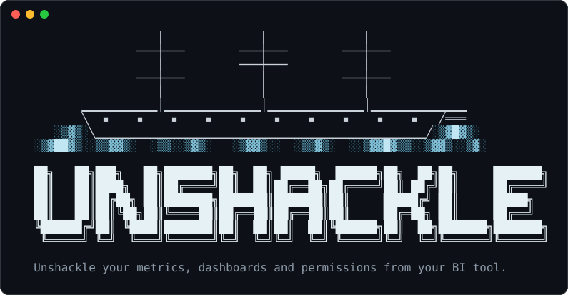

<h1 align="center">
  
</h1>

`unshackle` is a command-line tool for moving definitions out of a BI tool and into
files in a Git repository. It extracts the original definitions, translates what
it can, and lists what still needs work. You can run it without a coding agent.

It currently reads Looker, Lightdash, Omni, Hex, Sigma, ThoughtSpot, Power BI,
Tableau, Metabase, Apache Superset, and Redash. The generated files include
table descriptions, metrics, queries, dashboards, and permissions when the
source provides them.

## Try it without connecting a BI tool

```bash
git clone https://github.com/unshackle-analytics/unshackle
cd unshackle
uv venv
uv pip install -e ".[dev]"
./examples/tableau-demo/run.sh /tmp/acme
```

The demo reads a saved Tableau export, writes the generated files to
`/tmp/acme`, and compares one migrated dashboard query with Tableau's exported
results using a local DuckDB database. Open `/tmp/acme/migration/report.md` to
see what was translated and what remains.

## Use it with your BI tool

```bash
uv tool install "unshackle[run]"
unshackle tools
cd your-analytics-repo
unshackle migrate tableau
```

`unshackle tools` shows the environment variables each source needs. Set the ones
for your tool before running `migrate`; the access instructions are in the
relevant source guide under [`skills/`](skills/). `migrate` creates the folders,
inventories the source, saves its raw definitions, and builds the translated
files.

You can also run those steps separately with `unshackle init`, `unshackle inventory`,
`unshackle extract`, and `unshackle build`. The CLI runs in your terminal and connects
to the source tool's API when inventorying or extracting.

## No API access? Import files

If you can't get API credentials but can download definitions from the tool, import
the files instead of extracting:

```bash
unshackle init
unshackle import tableau "Superstore Sales.twbx" datasources/
unshackle build tableau
```

| Tool | What to import |
| --- | --- |
| Tableau | `.twb`, `.twbx`, `.tds`, `.tdsx` (extracts inside packaged files are ignored) |
| Power BI | a Power BI project (`.pbip` and its folders), with the semantic model saved as TMDL. Not `.pbix` |
| Looker | the LookML project folder (Git checkout or `.zip`) |
| Lightdash | the dbt project folder, plus `lightdash download` output if you have it |
| Omni | a model's YAML folder (from Git sync), one folder per model |
| ThoughtSpot | `.tml` files or the `.zip` from Export TML |
| Hex | project YAML (Git export) and `hex context semantic-project pull` output |
| Sigma | not supported: Sigma has no download of workbook or data model definitions |

`import` replaces `migration/raw/<tool>/` with the files, unpacking `.zip` downloads,
and never runs anything inside them. Files can't carry usage, sharing permissions
or, for most tools, the SQL the tool generates; Looker and Omni files carry no
dashboards. `migration/report.md` lists what is missing for each import.

## What it writes

| Path | Contents |
| --- | --- |
| `semantic/*.ossie.yaml` | [Apache Ossie](https://github.com/apache/ossie) semantic models and metrics, one document per model |
| `models/semantic/*.yml` | MetricFlow semantic models and metrics, only in dbt projects |
| `catalog/` | Table and column descriptions |
| `knowledge/` | Business context in Markdown |
| `queries/` | SQL or Python queries |
| `notebooks/*.ipynb` | Dashboards as Jupyter notebooks: SQL per tile, Altair (Vega-Lite) charts |
| `policies/` | Cedar policies and SQL row filters |
| `migration/raw/` | Definitions extracted from the source tool |
| `migration/report.md` | Counts, warnings, and unfinished translations |

If the target repo has `dbt_project.yml`, semantic files go to `models/semantic/`
and MetricFlow YAML is written next to the Ossie documents. Paths can be changed in `unshackle.toml`. The full
current layout is in [`spec/layout.md`](spec/layout.md).

When unshackle cannot translate something faithfully, it leaves a `TODO(unshackle)`
with the original expression. Run `unshackle todo` to find those items. The
instructions copied to `migration/skills/` can help a person or a coding agent
finish them, but using an agent is optional. Rebuilding preserves hand edits to
generated files and reports where it kept them.

## Check the results

`unshackle` does not automatically prove that every number matches the old tool.
Write comparison cases in `migration/parity/*.yaml`, then run `unshackle verify`
with a warehouse connection. It compares the source results with the migrated
query and records the outcome. See [`skills/verify/SKILL.md`](skills/verify/SKILL.md)
for the case format and process.

## Contributing

See [CONTRIBUTING.md](CONTRIBUTING.md). Source parsers are tested from saved
exports in `tests/fixtures/`, so most translation work doesn't need a live BI
account. Please report security issues privately; see [SECURITY.md](SECURITY.md).

Apache 2.0. Made by [Querio](https://querio.ai).
