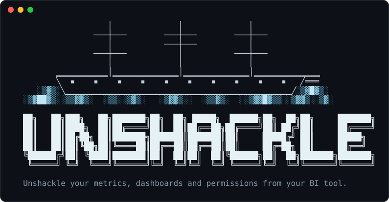

<h1 align="center">
  
</h1>

unshackle moves your metrics, dashboards and permissions out of a BI tool and into files in a Git repository you own.

## What you get

| You had in your BI tool | You get in your repo |
| --- | --- |
| Metrics, measures, calculated fields | Metrics in [Apache Ossie](https://github.com/apache/ossie), an open semantic-layer format (`semantic/`) |
| Dashboards | Jupyter notebooks: one SQL query and one chart per tile (`notebooks/`) |
| Tables and data sources | Table and column descriptions (`catalog/`) |
| Permissions, row-level security | [Cedar](https://www.cedarpolicy.com) policies and SQL row filters (`policies/`) |
| Descriptions, glossaries | Markdown (`knowledge/`) |

What unshackle can't translate faithfully is marked `TODO(unshackle)`, with the
original formula next to it. It doesn't guess.

## Start with your task

| You want to… | Start here |
| --- | --- |
| Move an existing BI tool and check what transferred | [Migrate, finish TODOs and verify](docs/migrate.md) |
| Build context from warehouse metadata, dbt or SQL | [Choose your inputs](docs/index.md#start-without-a-bi-export) |
| Ask Claude a question about your own data locally | [Local MCP setup and first question](docs/mcp.md) |
| Share the context and warehouse access with a team | [Host and connect clients](docs/deploy/README.md) |
| Refresh context, investigate drift or undo an update | [Maintain your context](docs/maintain.md) |

For a BI migration, install in a Python 3.11+ virtual environment, then run from
an analytics Git repository on a new branch:

```bash
python3 -m venv .venv
source .venv/bin/activate
python -m pip install unshackle
unshackle check <tool> --prompt
unshackle inventory <tool>
# Review visible content and choose scope before migrating.
unshackle migrate <tool> --only <id>
unshackle todo
```

Replace `<tool>` and `<id>` using the tool guide and inventory. `--only` is repeatable;
omit it only when the whole visible source is in scope. Credentials stay in the
ignored `.env`. Read `migration/report.md` for transferred files, warnings and gaps.
Migration writes definitions; resolving TODOs and [checking parity](skills/verify/SKILL.md)
are separate steps. Nothing changes in the source BI tool.

## Supported tools

| Tool | Maturity | Import files instead of the API |
| --- | --- | --- |
| [Tableau](docs/tools/tableau.md) | Most complete | `.twb`, `.twbx`, `.tds`, `.tdsx` |
| [Power BI](docs/tools/powerbi.md) | Real projects | Power BI project (`.pbip`, model as TMDL) |
| [Looker](docs/tools/looker.md) | Real projects | LookML project (Git checkout or `.zip`) |
| [Qlik Sense](docs/tools/qlik.md) | Saved exports | `qlik app unbuild` folder per app |
| [Amazon QuickSight](docs/tools/quicksight.md) | Saved exports | `.qs` asset bundle |
| [Metabase](docs/tools/metabase.md) | Saved exports | API only |
| [Lightdash](docs/tools/lightdash.md) | Saved exports | dbt project folder |
| [Apache Superset](docs/tools/superset.md) | Saved exports | export `.zip` |
| [Redash](docs/tools/redash.md) | Saved exports | API only |
| [Omni](docs/tools/omni.md) | Early | model YAML folder (Git sync) |
| [Hex](docs/tools/hex.md) | Early | project YAML (Git export) |
| [ThoughtSpot](docs/tools/thoughtspot.md) | Early | `.tml` files or Export TML `.zip` |
| [Sigma](docs/tools/sigma.md) | Early | API only |

**Maturity:** *Most complete*: the most translated and tested. *Real projects*: also tested on
open-source projects people built. *Saved exports*: tested on exports over a fictional dataset.
*Early*: the basics; expect more TODOs.

Each tool's page covers connecting, what you get, what's left to finish and how to check the numbers.

## With a coding agent

Point your agent at the initialized context repository's `AGENTS.md`. Migration
skills live under `migration/skills/`; the source checkout keeps them under
[`skills/`](skills/migrate/SKILL.md). Use the source-specific skill, the relevant
translation skill, then the verify skill. Preserve original expressions and unresolved
`TODO(unshackle)` markers. Reference SQL is not verified merely because it imported.

For agent access to context and bounded SQL, follow [MCP setup](docs/mcp.md).
One server uses one warehouse role. Everyone holding a hosted bearer token can query
that role's visible data; Cedar and row filters are context, not enforced authorization.
Use a read-only role, preferably against a production read replica. Git-hosted servers
do not receive ignored local data or credentials.

## Try it without a BI tool

```bash
git clone https://github.com/Querio-App/unshackle && cd unshackle
uv venv && uv pip install -e ".[dev]"
./examples/tableau-demo/run.sh /tmp/acme
```

The demo migrates a saved Tableau export into `/tmp/acme` and checks a dashboard's
numbers against Tableau's.

## More

- [Documentation by task](docs/index.md)
- [Repo layout](spec/layout.md): every folder and file unshackle writes
- [Contributing](CONTRIBUTING.md) · [Security](SECURITY.md) · [Changelog](CHANGELOG.md)
- [The name](docs/name.md): why a BI migration tool is named after Shackleton

Apache 2.0. Built and maintained by [Querio](https://querio.ai).
